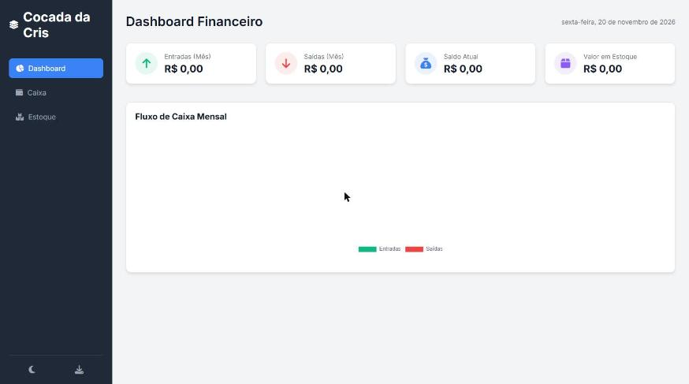

# Cocada da Cris Management System




> A web dashboard to manage the cash flow and inventory of Cocada da Cris, my family's sweets business. Everything runs in the browser, with no backend.

🔗 **Live demo:** [sistemacocadadacris.vercel.app](https://sistemacocadadacris.vercel.app)

## ✅ Features

- [x] Financial dashboard: monthly income, expenses, current balance and inventory value
- [x] Monthly cash flow chart with Chart.js
- [x] Cash register: income and expenses by category (sales, purchases, fixed costs, salaries and more)
- [x] Inventory control with quantity, unit cost and sale price
- [x] Register sales from stock, updating inventory and cash history automatically
- [x] Light and dark theme
- [x] Data saved in the browser with localStorage
- [x] Responsive layout with mobile menu

## 🛠 Technologies

    

## 💻 Prerequisites

Before you begin, make sure you have:

- A modern web browser (Chrome, Firefox, Edge or Safari)
- [Git](https://git-scm.com/) installed

## 🚀 Installing Cocada da Cris Management System

To install Cocada da Cris Management System, follow these steps:

Linux and macOS:

```bash
git clone https://github.com/NathanCarvalhodaCunha/Sistema_Cocada_da_Cris.git
cd Sistema_Cocada_da_Cris
```

Windows:

```powershell
git clone https://github.com/NathanCarvalhodaCunha/Sistema_Cocada_da_Cris.git
cd Sistema_Cocada_da_Cris
```

## ☕ Using Cocada da Cris Management System

To use Cocada da Cris Management System, follow these steps:

Open `index.html` in your browser, or use the live demo. Use the side menu to switch between **Dashboard**, **Caixa** (cash register) and **Estoque** (inventory). Data is stored in your browser's localStorage, so it stays on your device.

## 📁 Project structure

```
├── index.html   # dashboard, cash register and inventory screens
├── style.css
├── script.js    # storage, charts, cash and inventory logic
└── Icone.png
```

## 📫 Contributing to Cocada da Cris Management System

To contribute to Cocada da Cris Management System, follow these steps:

1. Fork this repository.
2. Create a branch: `git checkout -b <branch_name>`.
3. Make your changes and commit them: `git commit -m '<commit_message>'`
4. Push to the original branch: `git push origin <branch_name>`
5. Create the pull request.

Alternatively, see the GitHub documentation on [creating a pull request](https://docs.github.com/en/pull-requests/collaborating-with-pull-requests/proposing-changes-to-your-work-with-pull-requests/creating-a-pull-request).

## 🤝 Contributors

<table>
  <tr>
    <td align="center">
      <a href="https://github.com/NathanCarvalhodaCunha" title="Nathan Carvalho da Cunha on GitHub">
        <br>
        <sub>
          <b>Nathan Carvalho da Cunha</b>
        </sub>
      </a>
    </td>
  </tr>
</table>
